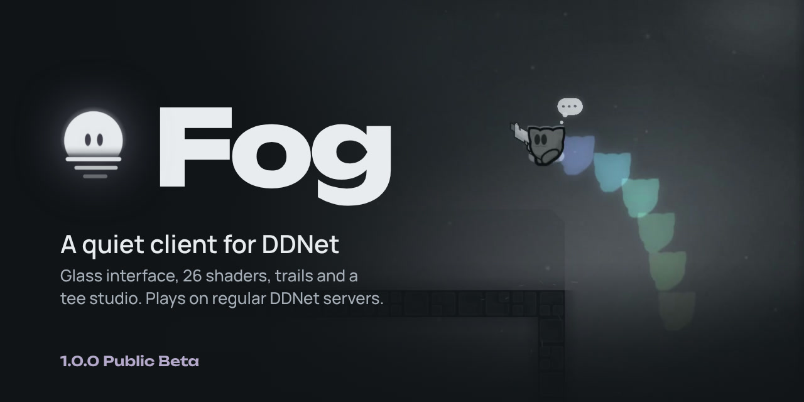
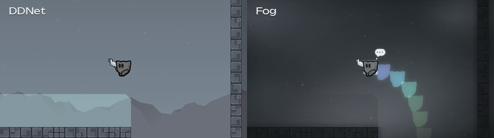
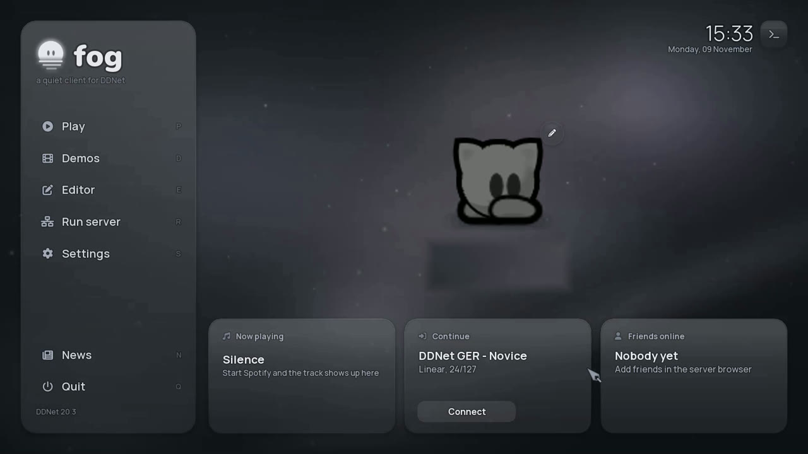
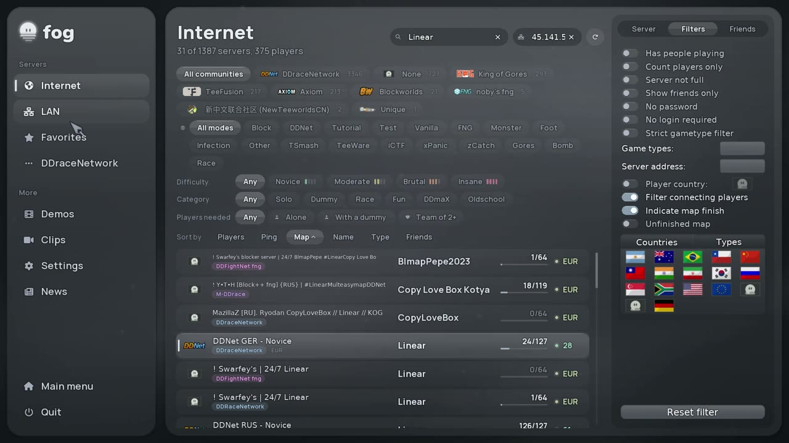
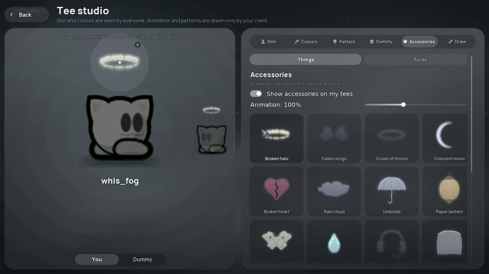
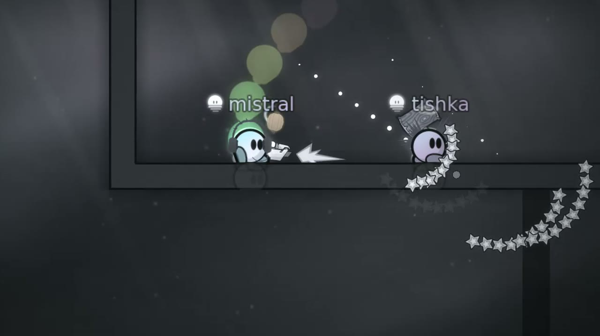
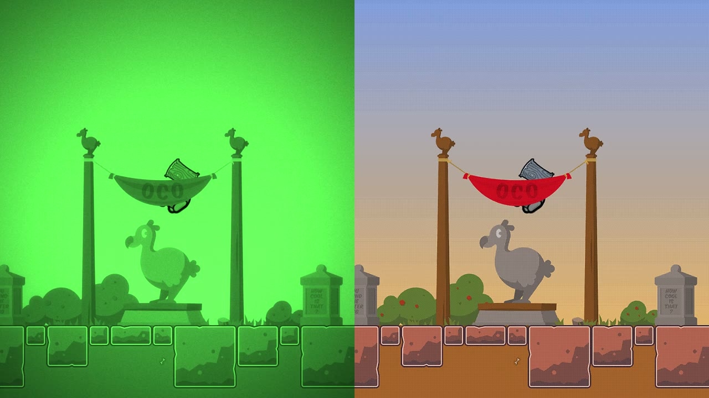
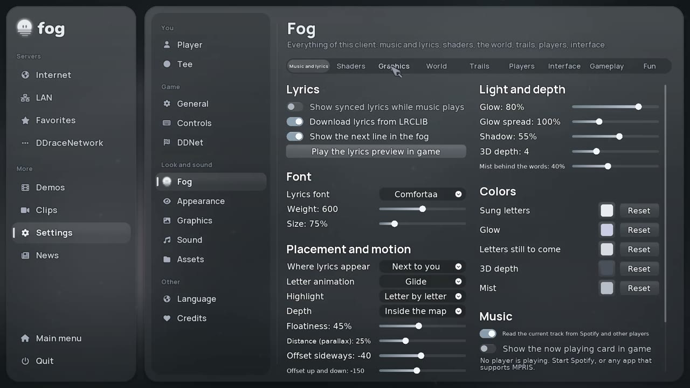

<p align="center">
  
</p>

<p align="center">
  <a href="https://github.com/babyycoded/fog/releases/tag/v1.0.0-beta"></a>
  <a href="https://github.com/babyycoded/fog/releases"></a>
  <a href="https://t.me/fogclient_tw"></a>
  <a href="https://github.com/babyycoded/fog/actions/workflows/fog-release.yml"></a>
</p>

Fog is a client for [DDNet](https://ddnet.org) with a reworked interface and a quiet, misty look. It connects to the same servers as DDNet and keeps all of its gameplay.

## Download

| System | File | |
| --- | --- | --- |
| Windows 10/11, 64-bit | [Fog-1.0.0-beta-win64.zip](https://github.com/babyycoded/fog/releases/download/v1.0.0-beta/Fog-1.0.0-beta-win64.zip) | Unpack, run `DDNet.exe` |
| Linux, x86_64 | [Fog-1.0.0-beta-linux_x86_64.tar.xz](https://github.com/babyycoded/fog/releases/download/v1.0.0-beta/Fog-1.0.0-beta-linux_x86_64.tar.xz) | Unpack, run `./DDNet` |

Updates and release notes come out first in the Telegram channel [@fogclient_tw](https://t.me/fogclient_tw). The 38-second trailer is attached to the release: [Fog-trailer.mp4](https://github.com/babyycoded/fog/releases/download/v1.0.0-beta/Fog-trailer.mp4).

## The same moment in DDNet and in Fog

<p align="center">
  
</p>

Both frames come from one demo, played back once in DDNet and once in Fog with its default look.

## A look around

<table>
  <tr>
    <td width="50%"><br><b>Start screen.</b> Your tee, what you are listening to, and the last server one click away.</td>
    <td width="50%"><br><b>Server browser.</b> Filter maps by difficulty, category and team size.</td>
  </tr>
  <tr>
    <td><br><b>Tee studio.</b> Colour animation, patterns, auras, outlines and 16 accessories.</td>
    <td><br><b>Seen by other Fog players.</b> Your name style, Fog mark and studio look show up for them too.</td>
  </tr>
  <tr>
    <td><br><b>26 shader presets.</b> Night vision and Comic here, applied live in game.</td>
    <td><br><b>Settings.</b> Every Fog feature has its own switch and sliders.</td>
  </tr>
</table>

<details>
<summary><b>Everything Fog adds</b></summary>

**Interface**
- Glass interface for the menus, start screen, Esc menu and settings
- Server browser filters: difficulty, category, players needed to finish
- Live menu backgrounds: fog, aurora, rain on glass, the deep, ember dusk
- Race HUD with checkpoint and finish moments, ping above names
- Menu cursors and Fog crosshairs with shape, size, gap and colour
- Drag and drop: drop a PNG onto the window and Fog asks whether it is a skin, game skin, emoticons, particles, HUD or entities, then puts it in place

**Graphics**
- 26 shader presets, plus bloom, grain, vignette, chromatic aberration, scanlines, pixelate and more
- Light shafts, ambient occlusion, rim light, wall shadows, soft shadows, reflections in the floor
- Depth of field for far background layers, motion blur
- Map fog that drifts at its own depth, a thin mist in front of the tees
- Weather (rain, snow, ash, pollen), day cycle by your clock, flashlight mode
- Fog versions of the standard tilesets, map tint toward the Fog palette
- Footprints, landing dust, wind lines, hook sparks, death ash, frost on frozen tees, finish confetti

**Your tee**
- Trails: Sandevistan, fog, glitch, phantom or your own colours
- Tee studio: breathing colours, gradients, rainbow, 9 patterns (or your own image), 6 auras, outlines
- Full-range custom colours, black included
- 16 accessories with their own animation
- Dummy sync: the dummy copies your look, or wears it inverted
- Name styles for other Fog players: shimmer, gradient, rainbow, pulse, wave

**Music**
- Reads the current track from Spotify and other players (MPRIS, Linux)
- Synced lyrics from LRCLIB, floating next to you or left in the map as you run
- Now playing widget, fog and auras that breathe with the music

**Play**
- Smooth katana: the ninja dash is predicted on your side, so it glides
- Fast input: your newest tick is predicted with the live input (about one tick less delay)
- Fog clips, sound packs, holidays (New Year, Halloween, Valentine's Day, March 8)
</details>

<details>
<summary><b>Questions</b></summary>

**Can I use Fog on DDNet servers?**
Yes. Fog is a DDNet client with visual and interface changes. It does not change what you send to the server beyond normal input. Follow each server's rules.

**Will it touch my DDNet settings?**
Fog uses the same settings folder as DDNet, so your binds, skins and servers carry over. Fog's own settings start with `fog_`. Back up `settings_ddnet.cfg` first if you switch between clients often.

**What does Fog send over the internet?**
Besides normal DDNet traffic: lyrics lookups go to lrclib.net, and the presence service sends your in-game name, the server you are on, a random Fog ID and your Fog style, so other Fog players can see your look. Turn it off with `fog_presence 0`.

**Linux: it does not start.**
The Linux build uses your system libraries. Install SDL2, FreeType, libpng, curl, FFmpeg and the Vulkan loader with your package manager, then run `./DDNet` from the unpacked folder.

**Where do I report a bug?**
Open an [issue](https://github.com/babyycoded/fog/issues) or write in [@fogclient_tw](https://t.me/fogclient_tw). Mention your system and what you did before it happened.
</details>

## Notes

- Fog is a third-party client. It is not affiliated with or endorsed by the DDNet team.
- This is a public beta: expect bugs.
- Fog is built on DDNet and keeps its licence (see `license.txt`). Fonts are under the SIL Open Font License, see `data/fonts/display/licenses`. The `whis_fog` skin is based on "whis" by Whis (CC-BY). The default sounds include the "Better soundpack" by Mezumi.
- Building works the same way as for DDNet; the original DDNet readme follows below.

---

[](https://ddnet.org)

[](https://github.com/ddnet/ddnet/actions/workflows/build.yml?branch=master)
[](https://codecov.io/gh/ddnet/ddnet/branch/master)
[](https://hosted.weblate.org/engage/ddnet/)

Our own flavor of DDRace, a Teeworlds mod. See the [website](https://ddnet.org) for more information.

Development discussions happen on #ddnet on Quakenet ([Webchat](http://webchat.quakenet.org/?channels=ddnet&uio=d4)) or on [Discord in the developer channel](https://discord.gg/xsEd9xu).

You can get binary releases on the [DDNet website](https://ddnet.org/downloads/), find it on [Steam](https://store.steampowered.com/app/412220/DDraceNetwork/) or [install from repository](#installation-from-repository).

- [Code Browser](https://ddnet.org/codebrowser/DDNet/)
- [Source Code Documentation](https://codedoc.ddnet.org/)
- [Building Guide](docs/BUILDING.md)
- [Debugging Guide](docs/DEBUGGING.md)
- [Contributing Guide](docs/CONTRIBUTING.md)

If you want to learn about the source code, you can check the [Development](https://wiki.ddnet.org/wiki/Development) article on the wiki.

## Cloning

To clone this repository with external libraries and no history (~700 MiB):

```sh
git clone --depth 1 --recursive --shallow-submodules https://github.com/ddnet/ddnet
```

To clone this repository when you have the necessary libraries on your system already with no history (~150 MiB):

```sh
git clone --depth 1 https://github.com/ddnet/ddnet
```

To clone this repository with external libraries and full history (~1 GiB):

```sh
git clone --recursive https://github.com/ddnet/ddnet
```

To clone this repository when you have the necessary libraries on your system already with full history (~450 MiB):

```sh
git clone https://github.com/ddnet/ddnet
```

To clone this repository since we moved the libraries to https://github.com/ddnet/ddnet-libs with history (~250 MiB):

```sh
git clone --shallow-exclude=included-libs https://github.com/ddnet/ddnet
```

To clone the libraries if you have previously cloned DDNet without them, or if you require the ddnet-libs history instead of a shallow clone:

```sh
git submodule update --init --recursive
```

## Dependencies on Linux / macOS

You can install the required libraries on your system, `touch CMakeLists.txt` and CMake will use the system-wide libraries by default. You can install all required dependencies and CMake on Debian or Ubuntu like this:

```sh
sudo apt install build-essential cargo cmake git glslang-tools google-mock libavcodec-extra libavdevice-dev libavfilter-dev libavformat-dev libavutil-dev libcurl4-openssl-dev libfreetype6-dev libglew-dev libnotify-dev libogg-dev libopus-dev libopusfile-dev libpng-dev libsdl2-dev libsqlite3-dev libssl-dev libvulkan-dev libwavpack-dev libx264-dev ninja-build python3 rustc spirv-tools
```
If your distribution doesn't ship with a `rustc` that is new enough, you can use `rustup` which automatically provides `rustc` 1.85.0 and above (this command removes `rustc` and reinstalls it as part of `rustup`.):
```sh
sudo apt install rustup
```

In case the `rustc` dependency doesn't have the required version for any reason:
```sh
sudo apt install rustup-1.85
```

On older distributions like Ubuntu 18.04 don't install `google-mock`, but instead set `-DDOWNLOAD_GTEST=ON` when building to get a more recent gtest/gmock version.

On older distributions `rustc` version might be too old, to get an up-to-date Rust compiler you can use [rustup](https://rustup.rs/) with stable channel instead or try the `rustc-mozilla` package.

Or on CentOS, RedHat and AlmaLinux like this:

```sh
sudo yum install cargo cmake ffmpeg-devel freetype-devel gcc gcc-c++ git glew-devel glslang gmock-devel gtest-devel libcurl-devel libnotify-devel libogg-devel libpng-devel libx264-devel ninja-build openssl-devel opus-devel opusfile-devel python3 rust SDL2-devel spirv-tools sqlite-devel vulkan-devel wavpack-devel
```

Or on Fedora like this:

```sh
sudo dnf install cargo cmake ffmpeg-devel freetype-devel gcc gcc-c++ git glew-devel glslang gmock-devel gtest-devel libcurl-devel libnotify-devel libogg-devel libpng-devel make ninja-build openssl-devel opus-devel opusfile-devel python SDL2-devel spirv-tools sqlite-devel vulkan-devel wavpack-devel x264-devel
```

Or on Arch Linux like this:

```sh
sudo pacman -S --needed base-devel cmake curl ffmpeg freetype2 git glew glslang gmock libnotify libpng ninja opusfile python rust sdl2 spirv-tools sqlite vulkan-headers vulkan-icd-loader wavpack x264
```

Or on Gentoo like this:

```sh
emerge --ask dev-build/ninja dev-db/sqlite dev-lang/rust-bin dev-libs/glib dev-libs/openssl dev-util/glslang dev-util/spirv-headers dev-util/spirv-tools media-libs/freetype media-libs/glew media-libs/libglvnd media-libs/libogg media-libs/libpng media-libs/libsdl2 media-libs/libsdl2[vulkan] media-libs/opus media-libs/opusfile media-libs/pnglite media-libs/vulkan-loader[layers] media-sound/wavpack media-video/ffmpeg net-misc/curl x11-libs/gdk-pixbuf x11-libs/libnotify
```

Or on Void Linux like this:

```sh
sudo xbps-install -S base-devel cargo cmake ffmpeg6-devel freetype-devel git glew-devel glslang gtest-devel libcurl-devel libnotify-devel libogg-devel libpng-devel ninja openssl-devel opus-devel opusfile-devel sqlite-devel SPIRV-Tools-devel vulkan-loader wavpack-devel x264-devel SDL2-devel
```

On macOS you can use [homebrew](https://brew.sh/) to install build dependencies like this:

```sh
brew install cmake ffmpeg freetype glew glslang googletest libpng molten-vk ninja opusfile rust SDL2 spirv-tools vulkan-headers wavpack x264
```

If you don't want to use the system libraries, you can pass the `-DPREFER_BUNDLED_LIBS=ON` parameter to cmake.

DDNet requires additional libraries, some of which are bundled for the most common platforms (Windows, Mac, Linux, all x86 and x86\_64) for convenience and the official builds. The bundled libraries for official builds are now in the ddnet-libs submodule. Note that when you build and develop locally, you should ideally use your system's package manager to install the dependencies, instead of relying on ddnet-libs submodule, which does not contain all dependencies anyway (e.g. openssl, vulkan). See the previous section for how to get the dependencies. Alternatively see our [Building Guide](docs/BUILDING.md) for how to disable some features and their dependencies (for example, `-DVULKAN=OFF` won't require Vulkan).

## Building on Linux and macOS

To compile DDNet yourself, execute the following commands in the source root:

```sh
cmake -Bbuild -GNinja
cmake --build build
```

## Building on Windows with the Visual Studio IDE

Download and install some version of [Microsoft Visual Studio](https://www.visualstudio.com/) (At the time of writing, MSVS Community 2022) with **C++ support**.

You'll have to install both [Python 3](https://www.python.org/downloads/) and [Rust](https://rustup.rs/) as well.

Make sure the MSVC build tools, C++ CMake-Tools and the latest Windows SDK version appropriate to your windows version are selected in the installer.

Now open up your Project folder, Visual Studio should automatically detect and configure your project using CMake.

On your tools hotbar next to the triangular "Run" Button, you can now select what you want to start (e.g game-client or game-server) and build it.

## Building on Windows with standalone MSVC build tools

First off you will need to install the following dependencies:

- [MSVC Build Tools](https://visualstudio.microsoft.com/visual-cpp-build-tools/),
- [Python 3](https://www.python.org/downloads/windows/),
- [Rust](https://www.rust-lang.org/tools/install).

To compile with the Vulkan graphics backend (disabled by default), you also need to install the [Vulkan SDK](https://vulkan.lunarg.com/sdk/home).

To compile and build DDNet on Windows, use your IDE of choice either with a CMake integration (e.g Visual Studio Code), or by ~~**deprecated**~~ using the CMake GUI.

Configure CMake to use the MSVC Build Tools appropriate to your System by your IDE's instructions.

If you're using Visual Studio Code, you can use the [CMake Tools](https://marketplace.visualstudio.com/items?itemName=ms-vscode.cmake-tools) extension to configure and build the project.

You can then open the project folder in Visual Studio Code and press `Ctrl+Shift+P` to open the command palette, then search for `CMake: Configure`.

This will open up a prompt for you to select a kit, select your `Visual Studio` version and save it. You can now use the GUI (bottom left) to compile and build your project.


<a href="https://repology.org/metapackage/ddnet/versions">
	
</a>

## Installation from Repository

Debian/Ubuntu

```sh
sudo apt-get install ddnet
```

MacOS

```sh
brew install --cask ddnet
```

Fedora

```sh
sudo dnf install ddnet
```

Arch Linux

```sh
yay -S ddnet
```

FreeBSD

```sh
sudo pkg install DDNet
```

Windows (Scoop)
```cmd
scoop bucket add games
scoop install games/ddnet
```

## Benchmarking

Detailed instructions can be found in [`docs/BENCHMARKING.md`](docs/BENCHMARKING.md).

## Working with the official DDNet Database

Detailed instructions can be found in [`docs/DATABASE.md`](docs/DATABASE.md).

## Debugging

Detailed instructions can be found in [`docs/DEBUGGING.md`](docs/DEBUGGING.md).

## Better Git Blame

First, use a better tool than `git blame` itself, e.g. [`tig`](https://jonas.github.io/tig/). There's probably a good UI for Windows, too. Alternatively, use the GitHub UI, click "Blame" in any file view.

For `tig`, use `tig blame path/to/file.cpp` to open the blame view, you can navigate with arrow keys or kj, press comma to go to the previous revision of the current line, q to quit.

Only then you could also set up git to ignore specific formatting revisions:

```sh
git config blame.ignoreRevsFile formatting-revs.txt
```

## (Neo)Vim Syntax Highlighting for config files

Copy the file detection and syntax files to your vim config folder:

```sh
# vim
cp -R other/vim/* ~/.vim/

# neovim
cp -R other/vim/* ~/.config/nvim/
```

## Precompiled Headers

By default precompiled headers are used for common system includes, see `src/pch.h`. In CI the Ubuntu 22.04 build disables precompiled headers to ensure we don't break compilation by forgetting includes. You might want to disable precompiled headers locally instead, at the cost of slower compile times, by setting `-DPRECOMPILE_HEADERS=OFF` in `cmake`.
